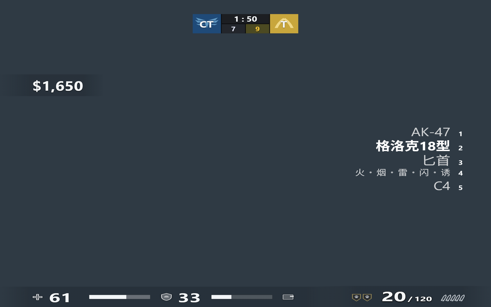
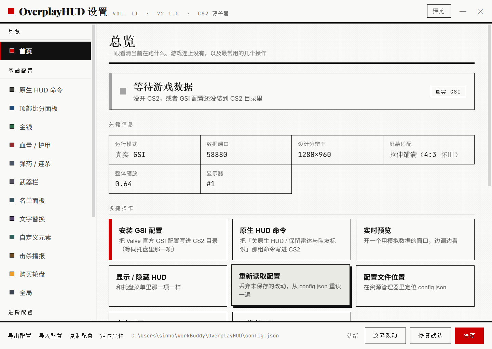
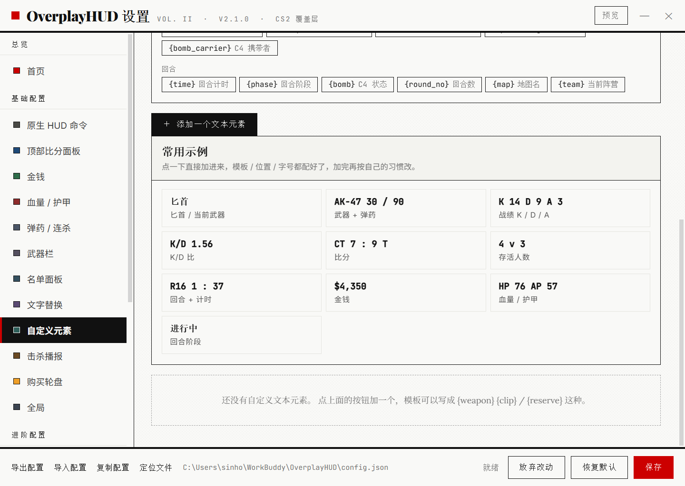
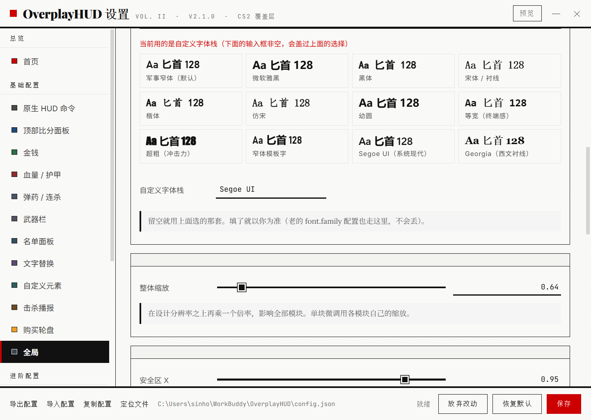
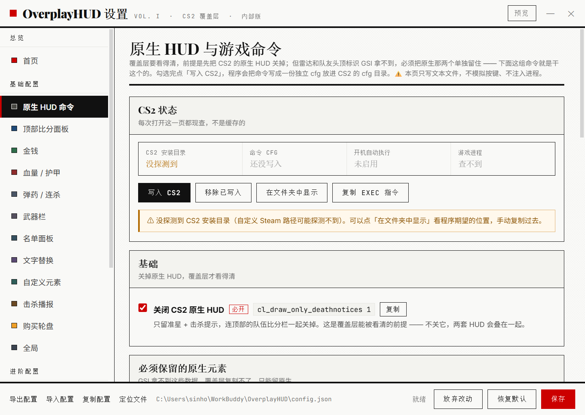
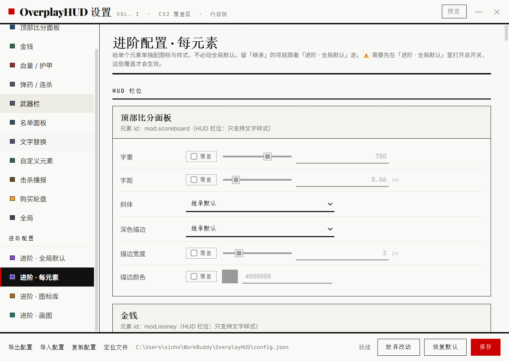
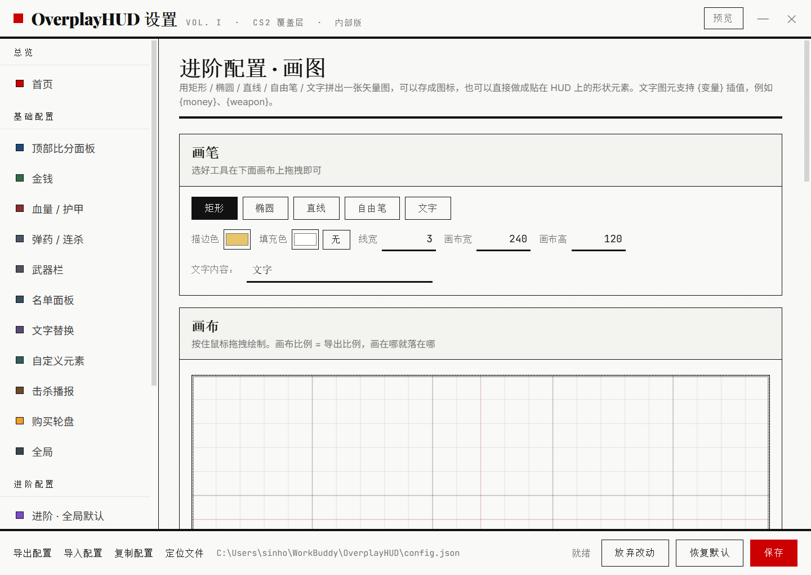
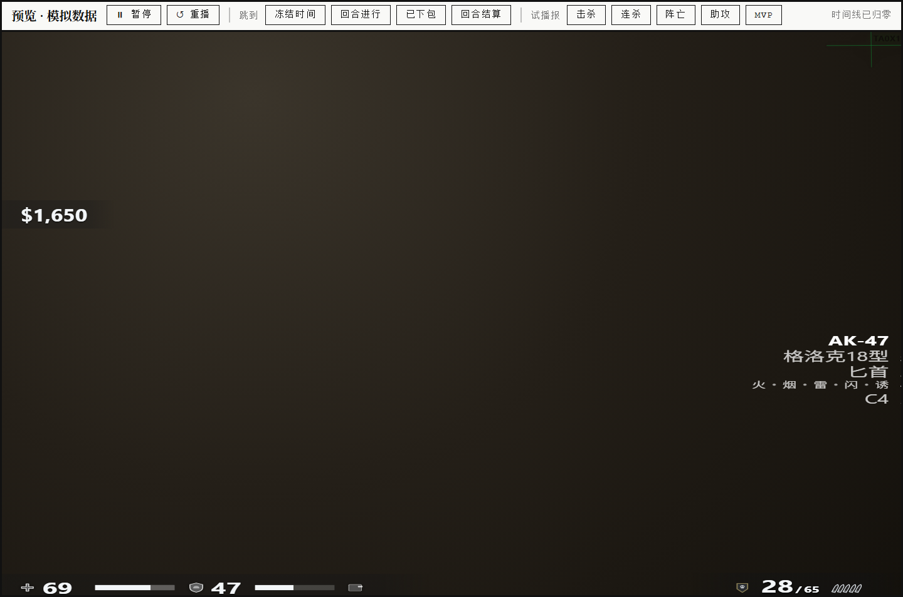
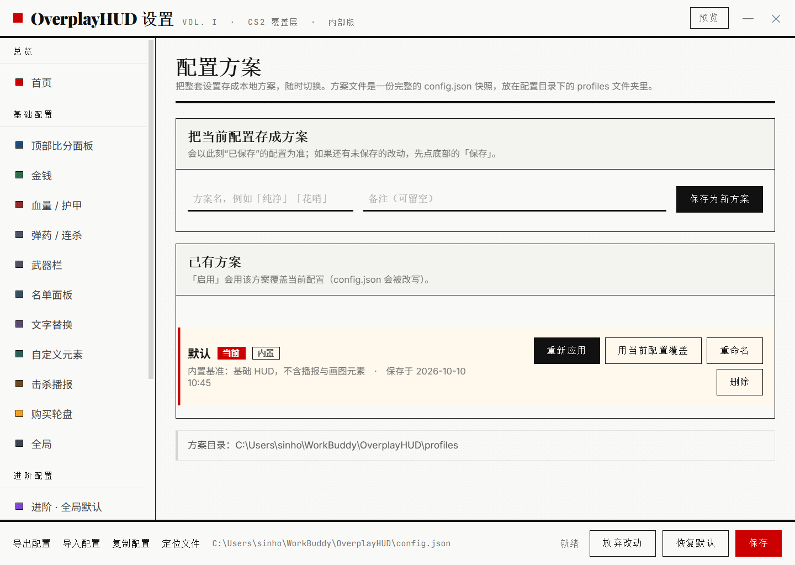

# OverplayHUD 使用说明

CS2 把老 HUD 换了，你想把 CS:GO 那套找回来 —— 这个程序就是干这个的。

它不碰游戏本身。原理只有一句话：把一份配置文件放进 CS2 的 cfg 目录，游戏就会在开局、掉血、击杀这些时刻，主动往 `127.0.0.1:58880` 发一份 JSON；程序收到之后，开一个透明窗口，把这些数据画在屏幕上。

没有读内存，没有注入 DLL，没有改任何游戏文件，也不会替你按键。

作者博客：[blog.taoxi.ink](https://blog.taoxi.ink) —— 更新公告和折腾过程都写在那儿。

---

## 一、先说清楚底线

这几条不会为了任何一个功能松口：

- 只接收 Valve 官方 GSI 主动发过来的数据
- 不读内存、不注入 DLL、不 hook 渲染、不改 vpk 或 panorama
- 不模拟任何按键、不代替你操作游戏
- 只显示普通玩家本来就看得到的信息，不带任何额外情报

**不要在有第三方反作弊的地方用。** Faceit、ESEA、5E、B5 这些平台有自己的反作弊系统，和 Valve 的 GSI 是两码事，出了问题不值得。

---

## 二、装上之后要做的三件事

### 1. 装 GSI 配置

打开设置，首页上有「安装 GSI 配置」，点一下就行。程序会自己找到 CS2 的安装目录，把 `gamestate_integration_overplayhud.cfg` 写进 `game\csgo\cfg\` 和 `game\core\cfg\` 两个地方。

> **这一步必须在启动 CS2 之前做。** GSI 配置只在游戏启动时读一次。游戏已经开着的话，改完要完全退出再重新打开 —— 退回主菜单再进不算。

如果自动探测不到 CS2（比如 Steam 装在自定义路径），首页会提示你，直接点「打开配置文件夹」，把那个 cfg 手动复制过去也行。

### 2. 关掉游戏原生 HUD

侧栏「原生 HUD 命令」这一页就是为这个准备的，见第五节。

### 3. 开一局看看

进游戏，右上角应该会出现顶部比分面板，屏幕底部是血量 / 护甲 / 弹药 / 武器栏：



想先看看效果又不想开游戏，就用「实时预览」—— 数据是模拟的，随便你怎么调。

---

## 三、界面长什么样



侧栏分成四组：

- **总览** —— 首页，一个运行仪表盘
- **基础配置** —— 原生 HUD 命令、各个 HUD 模块、文字替换、自定义元素、击杀播报、购买轮盘、全局
- **进阶配置** —— 全局默认外观、每元素覆盖、图标库、画图
- **工具与帮助** —— 配置方案、教程、关于

打开程序会**直接进设置界面**，不再只缩在右下角托盘里。（想改回去：「全局」页里关掉「启动时打开设置」。）

首页上那些按钮，是把托盘菜单里的东西全搬过来了：安装 GSI 配置、实时预览、显示/隐藏 HUD、重新读取配置、打开配置目录、开发者工具。状态栏每秒刷新一次，显示的是主进程的真实状态，不是缓存的。

---

## 四、基础配置

### 各个 HUD 模块

顶部比分面板、金钱、血量 / 护甲、弹药 / 连杀、武器栏，每个都能单独调位置、缩放、旋转、不透明度、辉光颜色。改完点保存，覆盖层立刻更新。

### 文字替换

改的是**显示出来的字**，逻辑完全不动。比如把「存活」改成「Alive」，把 AK-47 改成「阿卡」，投掷物单字「火烟雷闪诱」也可以换。

留空 = 用内置默认值。

### 自定义元素



想加什么字就加什么字，内容用 `{变量}` 插值。可用变量都在页面顶上列着，点一下就插进正在编辑的输入框；没在编辑就复制到剪贴板。

页面中间有「常用示例」，十个模板点一下就加进来 —— 位置和字号都配好了，加完再按自己习惯改。第一个就是**匕首**：模板是 `{weapon}`，你手里拿刀的时候它显示「匕首」，拿枪的时候显示枪名。

想自己在别处用这些变量，照着抄就行：

```
{weapon}  {clip} / {reserve}      →  AK-47  30 / 90
K {kills}  D {deaths}  A {assists}
{ct_score} : {t_score}
{health} / {armor}
```

### 击杀播报

击杀、连杀、阵亡、助攻、MVP 五类，每一类可以单独设锚点、位移、字号、颜色、动画时长。

如果是刀杀，播报里的武器名会显示「匕首」而不是 `weapon_knife`。

### 字体



「全局」页里能选 HUD 字体。内置了 12 套，每一格自己就用那套字体渲染，选之前先看效果 —— 字体的名字没什么意义，得看它把「匕首」这几个字写成什么样。

全都是系统自带字体，不联网下载。HUD 是盖在游戏画面上的，不能为了显示一行字去等字体加载。中文字体（雅黑 / 黑体 / 宋体 / 楷体 / 仿宋 / 幼圆）和西文字体（等宽 / 超粗 / 窄体模板字 / Georgia）都有。

最下面的输入框可以填任意 CSS `font-family`，非空时盖过上面的选择。老配置里存的字体串会继续生效，不会因为升级就变样。

---

## 五、原生 HUD 命令



覆盖层要看得清，前提是游戏自己的 HUD 别挡着。这一页把需要的那几条命令全 GUI 化了：

| 命令 | 干什么 |
| --- | --- |
| `cl_draw_only_deathnotices 1` | 关掉 CS2 原生 HUD，只留准星和击杀提示 |
| `cl_drawhud_force_radar 1` | 雷达单独保留 |
| `cl_drawhud_force_teamid_overhead 1` | 队友头顶标识 |
| `bind alt toggle cl_drawhud_force_deathnotices 1 0` | 按住 Alt 临时看原生 HUD |
| `r_drawtracers_firstperson false` | 关掉第一人称曳光弹 |

雷达和队友标识是**故意保留**的：GSI 拿不到玩家的坐标数据，覆盖层复刻不了，只能留给游戏自己画。

每条都能单独勾选、一键复制。页面顶部会现查四件事（CS2 装在哪、命令 cfg 在不在、autoexec 有没有写、游戏是不是正开着），下面是四个动作：

- **写入 CS2** —— 生成 `overplayhud_gamesetup.cfg` 放进两个 cfg 目录
- **移除已写入** —— 把上面那个文件删干净
- **在文件夹中显示** / **复制 exec 指令**

还支持写进 `autoexec.cfg`。勾上之后，程序会在你的 autoexec 里维护一段带标记的区块：

```cfg
// >>>>> OverplayHUD game setup (auto-generated) >>>>>
...
// <<<<< OverplayHUD game setup <<<<<
```

它只动这两行之间的内容。你自己写在上面的东西一个字都不会变，反复点写入也不会叠加出两份；点「移除」之后，autoexec 会逐字节还原成你原来的样子。

> 程序只往 cfg 目录写文本文件。命令生不生效完全由游戏自己决定 —— 它不替你按键。

---

## 六、进阶配置

基础配置管的是「显示什么」，进阶配置管的是「长什么样」。

### 全局默认



图标位置 / 间距 / 大小、字重、字距、斜体、描边、文字弯曲的半径和张角，还有入场缩放、入场时长和缓动、停留脉冲、淡出、HUD 抖动、手柄震动 —— 这些是全局默认值。

### 每元素覆盖

每个元素（5 个 HUD 栏位 + 5 类播报 + 你自己的自定义元素和形状）都能单独覆盖上面的任意一项。没写的那项就继承全局默认。

### 图标库

自己攒图标，三种来源：一段文字或 emoji、手绘的矢量图、图片。

图标会被播报和自定义元素引用（按 id）。每个元素的图标行里都能选「无图标（停用）」—— 这是彻底关掉图标的唯一方式，比清空 emoji 靠谱。

### 画图



矩形、椭圆、直线、自由笔、文字，描边 / 填充 / 线宽 / 画布尺寸都有，画完能存成图标，也能直接变成一块 HUD 形状元素。形状里的文本图元支持 `{变量}` 实时插值。

画布上铺了网格和红色中心十字，右下角实时显示坐标 —— 早先版本有个坐标对不准的 bug（画布高度写死，和 viewBox 比例不一致，等比缩放之后整体错位），现在盒子严格等于 viewBox 比例，鼠标画在哪，图元就落在哪。

> 粘贴进来的 SVG 不会被直接塞进页面。程序会先解析成一组白名单图元，再由自己重新画一遍，`script`、事件、外链一律丢掉。所以贴什么进来都不可能带脚本。

---

## 七、实时预览



调外观最烦的是「改完得开一局才知道对不对」。预览窗口就是解决这个的。

它本质上**是第二个 HUD 窗口**，跟真实覆盖层跑同一份渲染代码，只是数据来自内置的模拟时间线。所以不存在「预览看着好、实际不一样」。

顶部工具条能暂停、重播、跳到指定时间点，也能手动试播五种播报 —— 走的都是真实播报那条渲染路径。

窗口可以拖动、可以缩放。默认按你显示器的宽高比打开，因为真实覆盖层是铺满屏幕的，比例对上了位置才对。

三条入口等价：设置标题栏的「预览」按钮、托盘菜单、命令行 `--preview`。

---

## 八、配置方案



可以存多套配置，一键切换。存的位置：

- 开发时：项目根目录的 `profiles\`
- 打包版：`%APPDATA%\OverplayHUD\profiles\`

每个方案是一个 JSON，当前启用的是哪一套记在 `_active.json` 里（不写进 `config.json`，所以你的配置文件永远是干净的）。

第一次运行会自动生成一套内置的「默认」方案，内容是当时的配置**去掉播报和画图元素** —— 一个干净的基准，随时可以切回去。

---

## 九、关于


作者博客放在这一页最显眼的位置，按钮可以直接在浏览器里打开。

---

## 十、常见问题

**Q：写完命令了，原生 HUD 怎么还在？**

两种可能。一是没重启 CS2 —— GSI 和 cfg 都只在启动时读一次；二是命令写进了 `autoexec.cfg` 但游戏没执行它。CS2 需要在启动项里加 `+exec autoexec.cfg`，或者直接在控制台里 exec 一次。

**Q：HUD 全都不显示。**

先看首页的状态带。如果是「等待数据」，说明 GSI 配置没生效 —— 回到第二步。如果显示「已连上」但屏幕上看不到东西，检查显示器序号和整体缩放。

**Q：HUD 挡住鼠标了。**

「全局」页里的「鼠标可交互」被打开了。这是调试用的，正常玩要关掉。

**Q：为什么雷达、击杀提示没有复刻，还留着游戏的？**

GSI 不提供玩家坐标，也不提供击杀提示的完整数据。这两样复刻不出来，只能让游戏自己画。

**Q：名单面板 / 购买轮盘呢？**

都还在代码里，但默认关着。原因见下面「还没做完的部分」。

**Q：改了设置没反应。**

点右下角的「保存」。保存之前的改动只存在于预览里。

---

## 十一、还没做完的部分

老实说，有几块是半成品或者干脆停掉的：

**名单面板。** 本来想做死亡观战时显示双方存活名单。问题是 Valve 对 `allplayers` 这条数据下发的时机很挑剔 —— 大部分时候压根不下发，拿不到就是拿不到。与其显示一堆空位，不如关掉。代码留着，`show.roster` 改成 `true` 就能打开，但数据缺口不是我这边能解决的。

**购买轮盘。** 两级轮盘（分类扇区 → 具体武器），靠向游戏注入购买按键来实现。功能是通的，但它踩到了「不模拟输入」这条线 —— 虽然 Valve 对输入自动化一般只是踢人、不是 VAC，仍然没必要冒这个险。默认关掉了，代码完整保留，`buywheel.enabled` 改回 `true` 就能用。

**在配置面板里写代码。** 最早设想的是允许用户直接写脚本控制 HUD 行为。后来判断收益和风险不成比例：能做出来的效果，现在的「每元素 + 画图 + 形状元素」基本都能覆盖，而开放执行任意代码意味着每次都要重新论证一遍安全性。所以没做，短期内也不打算做。

**位置只能填数字。** 摆元素的位置现在是填 `offsetX / offsetY`，不能直接在预览窗口里拖。想过做拖拽，但鼠标穿透和可拖拽是互斥的，得单开一个「编辑模式」窗口，逻辑不复杂但要重做一遍坐标系，暂时搁置。

**图标库没有搜索和分类。** 图标多了以后只能一路滚。

**字体只能选系统自带的。** 不能导入字体文件 —— 一旦允许导入，就要处理字体在 asar 里的路径、加载时机、缺字回落，收益不大。

**播报触发类型有限。** 现在只有击杀 / 连杀 / 阵亡 / 助攻 / MVP 五类。像「残血警告」「对手连杀」「炸弹倒计时」这些，GSI 的数据够做，只是还没排上。

---

## 十二、技术上是怎么做的

写这部分是因为「为什么某些东西做不了」比「怎么用」更值得记一笔。

**窗口。** Electron 的无边框透明窗口，`setIgnoreMouseEvents(true, { forward: true })` 实现鼠标穿透。GPU 加速是主动关掉的 —— 它和某些覆盖层软件抢 GPU 缓存文件锁，会导致渲染进程崩溃，这个问题排查了很久。

**分辨率适配。** HUD 内部按一个「设计基准分辨率」排版（默认 1920×1080），再根据 `fit` 模式映射到真实屏幕：拉伸铺满、等比填满、完整显示三种。想做 CS:GO 那种 4:3 拉宽的怀旧感，就把基准设成 1280×960 再选「拉伸铺满」。另外还有安全区（跟 CS2 的 `safezonex` 对齐），不然覆盖层会和游戏原生元素错位。这套映射抽成了一个纯函数模块，Node 自检能直接对它做数学断言。

**数据流。** 游戏 POST → GsiHub 解析 → 快照 → IPC → 渲染层。这里踩过一个坑：GSI 只在**状态变化时**才下发某个组件，所以消费端必须假设「字段可能缺席」，缺了要沿用上一次的值。把缺席当成「归零」会导致一堆诡异 bug —— 比如回合阶段在冻结时间歇性抖动，比如站着不动被判定成退出了对局。

**共享逻辑。** 有几个模块要同时被三个地方用：HUD 渲染层、设置界面、无头自检。它们写成 UMD（Node 走 `module.exports`，浏览器挂 `globalThis`），只维护一份。不然迟早出现「设置界面里能调、HUD 里认不出来」。

**动画。** 入场、脉冲、抖动都用 Web Animations API 的**独立属性**（`scale`、`translate`），而不是 `transform`。因为锚点居中和 4:3 拉伸都在用 `transform`，动它会把这俩搞坏。

**手柄震动。** 走浏览器原生的 Gamepad API（`vibrationActuator.playEffect`），不经过游戏、不注入输入。要先按一下手柄授权，没有手柄就静默跳过。

**预览。** 没有另写一套模拟渲染 —— 预览就是第二个 HUD 窗口，只是 `?preview=1` 并且喂模拟数据。所见即所得是白拿的。

**安全。** 外部的 SVG 永远不直接进 DOM。粘贴的图形先被解析成一组白名单图元（矩形 / 椭圆 / 直线 / 折线 / 文本），颜色和路径数据都要过白名单校验，再由程序自己重建。截图里那些自定义形状，全是重建出来的。

**自检。** `npm run selftest` 会跑三百多条无头断言，覆盖配置归一化、几何计算、图元白名单、界面结构、文档口径。改完逻辑第一件事就是跑它。

---

## 十三、文件和命令

**配置存放位置**

- 开发时：项目根目录的 `config.json`
- 打包版：`%APPDATA%\OverplayHUD\config.json`

首次运行会把安装包里那份 config 复制过去当种子，所以「作者调好的样子」会跟着安装包走。

**常用命令**

```bash
npm run selftest      # 无头自检，改完逻辑先跑这个
npm run mock          # 不开游戏，用模拟数据看 HUD
npm run settings      # 直接打开设置界面
npm run verify        # 验证真实 GSI 是否连上
npm run install-cfg   # 命令行装 GSI 配置
npm run dist          # 打包（便携版 + 安装版，产物在 dist/）
```

**打包出来的东西**

- `OverplayHUD-<版本>-portable.exe` —— 双击就跑，不装
- `OverplayHUD-<版本>-setup.exe` —— 安装版，可以选目录、带快捷方式
- `dist/win-unpacked/` —— 免安装的目录版

---

*教程到这里。有问题去博客留言，或者直接改配置试 —— 反正每改一步都能在预览窗口里看到结果。*
